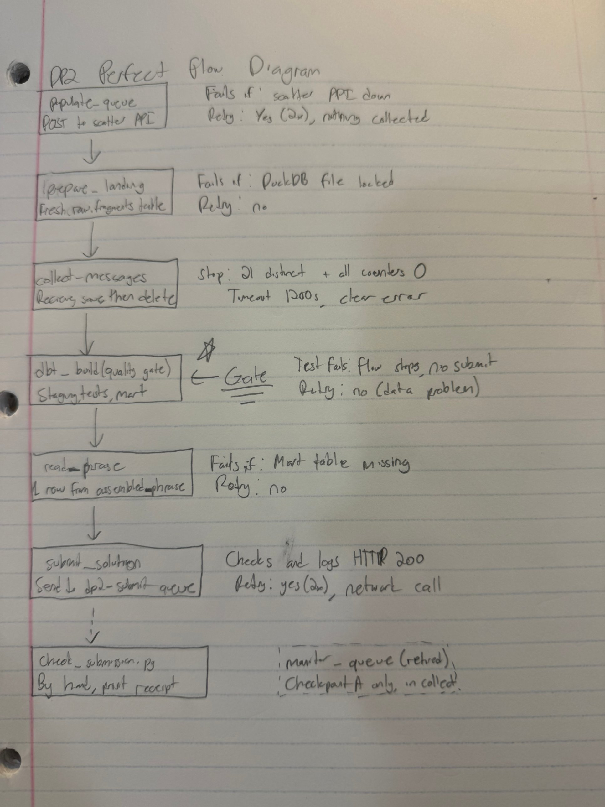
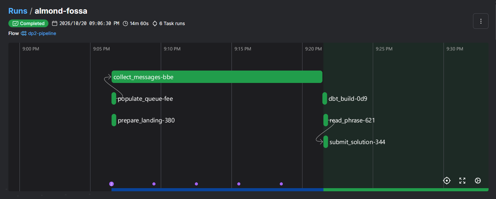

# DS 3022 Data Project 2: The SQS Puzzle

**Student:** shj2kb · **Platform:** Prefect · **Receipt code:** `F3C00E08C5`

```
$ python kit/check_submission.py --verify shj2kb prefect F3C00E08C5
VALID receipt
```

A Prefect pipeline that fills a local SQS queue with 21 out-of-order, randomly delayed messages, collects every one of them into DuckDB, lets dbt tests decide whether the data is trustworthy, rebuilds the phrase with a dbt model, and submits it to `dp2-submit`.

Reassembled phrase:

> Read the message, save the message, then delete the message, because a crash in between should never lose your hard work.

---

## 1. Setup and run

Tested on Windows 11 (PowerShell) with Python 3.14. Python 3.12 or 3.13 is recommended by the course and should work the same.

### Once

```powershell
git clone https://github.com/TheNel13/ds3022-dp2-starter.git
cd ds3022-dp2-starter
py -3.12 -m venv .venv                 # macOS/Linux: python3 -m venv .venv
.venv\Scripts\Activate.ps1             # macOS/Linux: source .venv/bin/activate
pip install -r requirements.txt
copy .env.example .env                 # macOS/Linux: cp .env.example .env
```

Edit `.env` and set `UVA_ID` to your computing ID. Keep `DP2_FAST=1` and `DP2_CHAOS=0` for a quick run.

### Every time: four terminals (activate the venv in each one first)

| Terminal | Command | Purpose |
|---|---|---|
| T1 | `moto_server -p 9324` | Local SQS emulator |
| T2 | `python kit/scatter_api.py` | Scatter API that fills the queue |
| T4 | `prefect config set PREFECT_API_URL="http://127.0.0.1:4200/api"` then `prefect server start` | Prefect dashboard at http://127.0.0.1:4200 |
| T3 | `python kit/smoke_test.py`, then the commands below | Work terminal |

### Run the pipeline (one command, no manual steps)

```powershell
python prefect-flow.py
python kit/check_submission.py     # prints PASS and the receipt code
```

`python prefect-flow.py` goes from the POST to the submission by itself. `check_submission.py` is only the checker from the kit.

### Windows problems I hit, and the fixes

| Symptom | Cause | Fix |
|---|---|---|
| `pip install` hung on `dbt-core-experimental-parser` | No ready-made Windows wheel, so pip tried to build it from source | It was building from source; it finished after several minutes. Python 3.12/3.13 avoids the build |
| `prefect server start`: `ImportError: DLL load failed ... An Application Control policy has blocked this file` (`sqlalchemy\engine\_processors_cy`) | Windows Smart App Control blocks SQLAlchemy 2.1's compiled extension | `pip install "sqlalchemy>=2.0.40,<2.1"` and set `$env:DISABLE_SQLALCHEMY_CEXT_RUNTIME = "1"` in the Prefect terminal |
| `source` not recognised | PowerShell, not bash | `.venv\Scripts\Activate.ps1` |
| Scatter API returns HTTP 500 on a quick re-run | SQS allows one `PurgeQueue` per queue every 60 s (see Chaos round) | Wait 60 s between runs; `populate_queue` now retries after 65 s |

---

## 2. Architecture and DAG



| Task | Input → output | What can fail | Retry? |
|---|---|---|---|
| `populate_queue` | → queue URL | Scatter API down or returns 500 | Yes, 2× with 65 s delay. Safe because nothing has been collected yet |
| `prepare_landing` | → empty `raw.fragments` | DuckDB file locked | No |
| `collect_messages` | queue URL → 21 rows in DuckDB | Messages never arrive, malformed messages | No retry; it has its own 1,200 s timeout |
| `dbt_build` | `raw.fragments` → `stg_fragments`, tests, `assembled_phrase` | A data test fails | **No.** A failed test is a data problem, so retrying gives the same answer |
| `read_phrase` | mart → phrase string | Mart table missing | No |
| `submit_solution` | phrase → HTTP 200 | Network error | Yes, 2×. It is a network call and only runs after dbt passed |
| `check_submission.py` (by hand) | `dp2-submit` → PASS + receipt | | |

Each task's return value is the next task's input, and every task raises on failure. So if one task fails, nothing after it runs: a bad phrase can never be submitted.

`monitor_queue` from Checkpoint A is still in the file but no longer called. `collect_messages` watches the same three counters itself while it receives.

**Why the POST is never repeated:** each POST to the scatter API purges the queue and sends all 21 messages again. If the POST ran inside a retry after collection had started, or on every scheduled run, it would wipe messages I was halfway through collecting. So `populate_queue` runs once per flow run, and its retries only happen if the POST itself failed.

---

## 3. Polling strategy

**What I chose:** a loop that, on every pass,

1. reads the three counters with `get_queue_attributes` (`ApproximateNumberOfMessages`, `...NotVisible`, `...Delayed`) and logs them together with how many distinct fragments are stored;
2. long-polls `receive_message(MaxNumberOfMessages=10, WaitTimeSeconds=10, MessageAttributeNames=["All"])`, which waits up to 10 s for a message instead of returning empty immediately;
3. saves and deletes whatever arrived.

**Stop rule:** stop only when **21 distinct `order_no` are stored AND all three counters are 0**. Either half alone is not enough: `Delayed = 0` says nothing about what I saved, and "21 received" can count the same message twice.

**Timeout:** 1,200 s, which is longer than the 900 s maximum delay. If it is reached, the task raises `TimeoutError: Only N/21 fragments after 1200 s`, so the run fails clearly instead of hanging. Evidence of a forced 15 s timeout: [docs/timeout-test.png](docs/timeout-test.png).

**Why:** it combines the two good options from class. Logging the counters every pass makes progress visible in the Prefect logs (you can watch `delayed` fall and `stored` rise). Long polling finishes as soon as the last message is released, and makes far fewer empty calls than a fixed `sleep` loop.

**What I rejected:**
- *Sleep 900 s, then drain:* always waits the worst case, even in fast mode, and silently misses a message that is delayed longer than assumed.
- *Short polling every second:* works, but makes many empty API calls and adds nothing over long polling.
- *Stopping when `Delayed = 0`:* messages can still be visible or in flight at that moment, so it would stop too early.

---

## 4. Receive → save → delete, and idempotency

The order inside the loop is **receive → insert into `raw.fragments` → `delete_message` with that message's `ReceiptHandle`**.

What happens if the flow crashes between steps:

| Crash point | Result |
|---|---|
| After receive, before save | Nothing stored, nothing deleted. After the visibility timeout the message becomes visible again and can be received again. **Nothing lost.** |
| After save, before delete | The row is stored but the message is redelivered, so the fragment is saved twice. **A duplicate, not a loss.** |
| If I had used receive → delete → save | A crash after delete loses the word for good: SQS never delivers a deleted message again. That is why I never delete first. |

In this project a crashed run is recovered by simply re-running the flow, which POSTs again and starts a fresh puzzle. The order still matters: within a run, and in any real queue that is not re-filled, deleting before saving would lose data permanently, while saving before deleting can at worst create a duplicate.

This is SQS's at-least-once delivery: duplicates are normal. I made the pipeline **idempotent** so a duplicate is counted once:
- the stop rule counts `count(distinct order_no)`, so a duplicate can never make the flow stop early;
- `stg_fragments` uses `select distinct` on `(order_no, word)`, so an exact duplicate collapses into one row;
- `raw.fragments` keeps every message exactly as it arrived, which is useful for debugging.

`prepare_landing` is a separate task that recreates `raw.fragments` at the start of each puzzle. It is separate on purpose: if `collect_messages` were ever re-run, it must not wipe rows whose messages have already been deleted from the queue.

---

## 5. dbt quality gate

```
dbt/
  models/sources.yml                      raw.fragments (landed by Prefect)
  models/staging/stg_fragments.sql        cast order_no to integer, trim word, select distinct
  models/staging/schema.yml               not_null + unique on order_no, not_null on word
  tests/assert_complete_sequence.sql      exactly 21 fragments, numbered 1..21, no gaps
  models/marts/assembled_phrase.sql       string_agg(word, ' ' order by order_no)
```

- `order_no` arrives as text, and sorted as text `"10"` comes before `"2"`. Casting it to an integer in staging fixes the order.
- The flow runs `dbt build` through `dbtRunner`. If `res.success` is false the task raises, so `read_phrase` and `submit_solution` never run.
- Because the mart uses `ref('stg_fragments')`, dbt runs the tests on staging first and **skips** `assembled_phrase` if any of them fails.

### Proof the gate can fail, then pass

| Change to `raw.fragments` | Result | Evidence |
|---|---|---|
| Delete `order_no = 7` | `assert_complete_sequence` FAIL, `assembled_phrase` SKIP | [docs/dbt-fail-missing.png](docs/dbt-fail-missing.png) |
| Add a second word `'oops'` for `order_no = 7` | `unique_stg_fragments_order_no` FAIL (and the singular test, since there are 22 rows), mart SKIP | [docs/dbt-fail-conflict.png](docs/dbt-fail-conflict.png) |
| Fresh flow run | `PASS=6 WARN=0 ERROR=0 SKIP=0` | [docs/dbt-pass.png](docs/dbt-pass.png) |

An **exact** duplicate row passes on purpose: it is a redelivered message, and `distinct` removes it. A **different** word for the same position is a real conflict that no phrase can be built from, so the gate must stop the flow. (The course's CHECKPOINTS.md says "duplicate a row" to make a test fail; I followed the Lesson 10 correction instead.)

---

## 6. Chaos round

Chaos mode (`DP2_CHAOS=1`) sends 24 messages: the 21 fragments, 2 duplicate copies, and 1 "poison" message with `order_no="?"` and no `word` attribute.

### What broke, and why

1. **Crash on the poison message.** `collect_messages` read `attrs["word"]` directly, so the poison message raised `KeyError: 'word'`. The flow failed at 18/21, and dbt and submit never ran. ([docs/chaos-before.png](docs/chaos-before.png))
   *Nothing was lost*, because I save before I delete: the poison message, and anything after it in the same batch of up to 10, was never deleted, so it would become visible again after the visibility timeout. But every chaos run contains a poison message, so the pipeline would crash every time and never finish.
2. **HTTP 500 from the scatter API on the re-run.** The real error was `PurgeQueueInProgress: Only one PurgeQueue operation on shj2kb is allowed every 60 seconds`. Each POST purges my queue, and a POST arrived less than 60 s after the previous one (I confirmed this by sending two POSTs a few seconds apart: the first returned 200, the second returned 500 with this error). My `populate_queue` retries came only 5 s apart, so they were still inside the 60 s window and failed too.

### How I fixed it

1. Read the attributes with `.get()`. If `word` is missing or `order_no` is not a number, **log a warning and delete the message** without storing it, so it can neither block the queue nor reach dbt:
   `WARNING Malformed message fe327066-... skipped and deleted: order_no='?' word=None`
2. Log duplicates (`Duplicate of order_no 7 received, will be counted once`) and still store them in raw. `count(distinct)` and dbt's `distinct` count them once.
3. Changed `populate_queue` to `retry_delay_seconds=65`, so a retry waits past SQS's 60 s purge limit.

### Result: two consecutive chaos runs end in PASS

| Run | Duplicates | Poison | End state | Checker |
|---|---|---|---|---|
| 1 | order_no 7 and 2, counted once | logged and deleted | `stored 21/21 \| visible=0 in_flight=0 delayed=0` | PASS, `F3C00E08C5` |
| 2 | order_no 18 and 15, counted once | logged and deleted | `stored 21/21 \| visible=0 in_flight=0 delayed=0` | PASS, `F3C00E08C5` |

Evidence: run 1 ([part 1](docs/chaos-run-1-part1.png), [part 2](docs/chaos-run-1-part2.png)), run 2 ([part 1](docs/chaos-run-2-part1.png), [part 2](docs/chaos-run-2-part2.png))

---

## 7. Tool roles

| Tool | Role here | What I would lose without it |
|---|---|---|
| **Prefect** | Orchestrates the six tasks in order, retries the two network tasks, enforces "nothing runs after a failure", and keeps logs and run history in the dashboard | I would be hand-writing retry logic, dependency order and logging, with no dashboard to prove what happened on each run |
| **DuckDB** | Durable landing zone (`raw.fragments`) between receive and delete, and the warehouse dbt builds in | No safe place to save a fragment before deleting it. Keeping fragments in a Python list would lose them all on a crash, after their messages were already deleted |
| **dbt** | Types and de-duplicates the data, tests it, and builds the phrase only if every test passes | The checks would be ad-hoc Python asserts: not written down, not shown as PASS/FAIL, and easy to skip. A wrong phrase could leave my laptop |

---

## 8. Results

| Evidence | File |
|---|---|
| Checkpoint A run (populate + monitor) | [docs/checkpoint-a-run.png](docs/checkpoint-a-run.png) |
| Collect run, counters to 0 | [docs/checkpoint-b-log1.png](docs/checkpoint-b-log1.png), [log2](docs/checkpoint-b-log2.png), [log3](docs/checkpoint-b-log3.png) |
| Timeout fails clearly | [docs/timeout-test.png](docs/timeout-test.png) |
| Full flow, fast mode, all tasks green | [docs/full-run-fast.png](docs/full-run-fast.png) |
| **Full-delay run (`DP2_FAST=0`, 30–900 s)** | [docs/full-delay-run.png](docs/full-delay-run.png) |
| dbt output | [docs/dbt-pass.png](docs/dbt-pass.png) |
| Receipt (`PASS shj2kb / prefect receipt: F3C00E08C5`) | [docs/receipt.png](docs/receipt.png) |



---

## 9. Repository hygiene

- Fork of the assignment repository; `kit/` is unmodified.
- `.env`, `*.duckdb`, `dbt/target/`, `dbt/logs/` and log files are git-ignored and not committed (checked with `git status` before every commit).
- Logging uses Prefect's `get_run_logger`; no log files are written to the repo.
